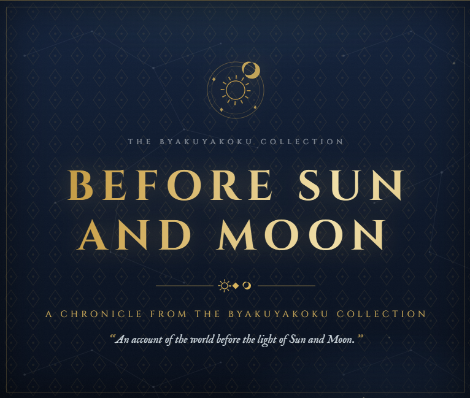

# Before Sun and Moon — An Enkanomiya Manuscript Artifact

An interactive, single-file HTML page that transforms the forbidden in-game chronicle
***Before Sun and Moon*** (Vol. II of *The Byakuyakoku Collection*, Enkanomiya) into a
beautiful, immersive ancient manuscript — as if recovered from the deepest archives
beneath Enkanomiya.



---

## 🚀 Quick start

No build step, no dependencies, no frameworks. Just open the file:

```bash
# Option 1: simply double-click index.html
# Option 2: serve it locally (recommended, enables Google Fonts cleanly)
python3 -m http.server 8000
# then visit http://localhost:8000
```

> **Note:** the page uses Google Fonts (Cinzel, Cormorant Garamond, IM Fell English),
> so an internet connection is needed for the full typography. Offline, it gracefully
> falls back to system serif fonts (Palatino / Georgia / Times).

To deploy on GitHub Pages: push this repo and enable **Settings → Pages → Deploy from
branch → `main` / root**. The site will be live at `https://<username>.github.io/<repo>/`.

---

## 📁 Project structure

```text
.
├── audio/
│   ├── ATTRIBUTION.md                       # music credits / licenses
│   ├── drift-along-the-lethe.mp3           # your tracks (see TRACKS in script.js)
│   ├── hope-or-nostalgia.mp3
│   ├── now-and-forevermore.mp3
│   └── tearless-souls-of-byakuyakoku.mp3
├── imgs/
│   └── before-sun-and-moon.png             # real screenshot shown at the top of this README
├── README.md                               # this file
├── index.html                              # markup only – links to the stylesheet and script
├── script.js                               # scroll reveals, motes, cursor sparkles, sound toggle
└── style.css                               # all styles: palette, parchment, cover, chapters, motion
```

Clean separation of concerns: **HTML for structure, CSS for presentation, JS for
animation**. There is nothing to install — just open `index.html`.

---

## ✨ Features

- **Ancient manuscript aesthetic** — aged parchment with procedural grain (SVG
  `feTurbulence`), weathering stains, an engraved double gold frame, SVG corner
  flourishes, and a vertical archival margin note.
- **Night-archive backdrop** — deep midnight blue with faint constellation lines,
  a vignette, and sparse drifting golden dust motes.
- **Title page** — dark "night of Enkanomiya" cover with a glowing sun-and-moon
  sigil, shimmering antique-gold title, and the inscription.
- **Lore-faithful typography** — Cinzel (titles/headings), Cormorant Garamond (body),
  IM Fell English (the scribe's invocation and quotations), with a drop cap.
- **Chapter design** — every original heading rendered as a manuscript chapter with
  celestial diamond ornaments; the six major sections (On Phanes… The Parable of the
  Tree) receive enlarged headings and sun–moon dividers; the original `...` redaction
  headings render as ornamental dividers.
- **Forbidden knowledge treatment** — sacred names (the Primordial One, the Second Who
  Came, the Seven Sovereigns, the Ruler of Time, Kairos, Tokoyo Ookami) get a restrained
  gold emphasis; the **Htoratsi** passage sits in a sealed midnight inset with a wax-seal
  SVG and a glowing inscribed name.
- **Restrained motion** — page fade-in, scroll reveals, hover glows, gold shimmer,
  smooth scrolling. Fully disabled under `prefers-reduced-motion`, and the page is
  completely readable with JavaScript disabled.
- **Content integrity** — every heading, paragraph, and line break of the original
  document is preserved verbatim and in original order (verified programmatically).
- **Responsive & accessible** — semantic HTML (`main`/`header`/`section`/`footer`),
  controlled reading width (~44rem), readable contrast, mobile-friendly breakpoints.

---

## 🎨 Customizing the look

All colors are CSS custom properties at the top of **`style.css`** (the `:root` block):

```css
:root {
    --ink: #2f2317;        /* dark ink brown (body text)        */
    --parch-1: #f4ecd9;    /* aged parchment                     */
    --gold: #b08a3c;       /* muted antique gold                 */
    --night-1: #0a1220;    /* deep midnight blue (page backdrop) */
    --teal: #5d8a83;       /* desaturated celestial teal         */
    --silver: #dfe3e6;     /* faint silver / moonlight           */
    ...
}
```

Change a variable and the whole manuscript re-themes instantly. Fonts are loaded via
one Google Fonts `<link>` in the `<head>` of `index.html` — swap the `family=`
parameters to change typefaces. Animations live in `script.js` and can be deleted
entirely; the page remains fully readable without JavaScript.

---

## 🧾 Content source

The text is the canonical *Before Sun and Moon* chronicle from **Genshin Impact**
(HoYoverse), Vol. II of the Byakuyakoku Collection. All original text is preserved
unchanged. Genshin Impact and all related names are property of HoYoverse; this is an
unofficial fan-made art project.

---

## 📜 License

The code (`index.html`, `style.css`, `script.js`) may be reused freely for personal/fan projects.
The lore text itself © HoYoverse — please respect their IP when redistributing.
